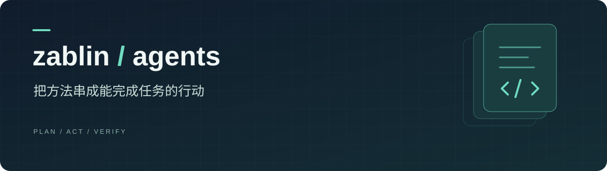

<p align="center">
  
</p>

<p align="center">
  <strong>目标 · 行动 · 验证</strong><br />
  我的个人 AI Agent 项目集，记录从明确任务到交付结果的实践。
</p>

<p align="center">
  <a href="#项目目录">项目目录</a> ·
  <a href="#如何使用">如何使用</a> ·
  <a href="#仓库结构">仓库结构</a> ·
  <a href="#相关仓库">相关仓库</a>
</p>

---

## 关于这个仓库

让方法走进实际任务。

这里存放我制作和持续改进的 AI Agent：围绕一个明确目标，组织所需的上下文、工具与执行步骤，并检查最终结果是否满足要求。

每个项目都会说明三件事：**解决什么问题、如何运行、怎样验证结果。**

## 项目目录

目前尚未收录 Agent 项目。首个项目发布后，这里将提供项目入口、用途和状态，方便查找与使用。

## 如何使用

项目收录后，先阅读对应目录中的 `README.md`，确认运行环境、依赖与配置要求，再按项目说明启动。

每个项目的说明将包含：

1. **任务与输入**：适合处理什么问题，需要提供哪些材料。
2. **配置与运行**：需要哪些工具、授权和依赖，如何开始执行。
3. **结果与验证**：会交付什么，如何检查结果是否符合预期。

当前尚无可运行项目，运行命令和调用示例将随具体项目一并发布。

## 仓库结构

当前内容：

```text
zablin-Agents/
├── README.md              # 项目导航与使用说明
└── assets/
    └── banner.svg         # 首页封面
```

后续项目统一收录到 `agents/<agent-name>/`，每个项目提供自己的 `README.md`，按实际需要附上代码、配置示例和使用案例。

## 维护方式

- **围绕具体目标**：明确任务范围、完成条件与适用边界。
- **先验证再收录**：提供一次可复现的运行示例及结果检查方式。
- **保持配置清晰**：说明工具依赖与授权要求；密钥通过本地配置提供，不写入仓库。
- **随实践持续改进**：根据实际使用反馈调整流程，记录重要变化。
- **注明参考来源**：改编或引用他人项目时，保留出处并遵守原许可。

## 相关仓库

| 仓库 | 内容 |
| --- | --- |
| [zablin-skills](https://github.com/zablin/zablin-skills) | 可复用的学习、阅读与研究方法。 |
| [zablin-Agents](https://github.com/zablin/zablin-Agents) | 围绕具体任务组织工具与步骤的 Agent 项目。 |

Agent 可以按需调用 Skill，把单项方法用在完整任务中。

---

<p align="center"><sub>由 <a href="https://github.com/zablin">zablin</a> 持续整理</sub></p>
